# TutorHub

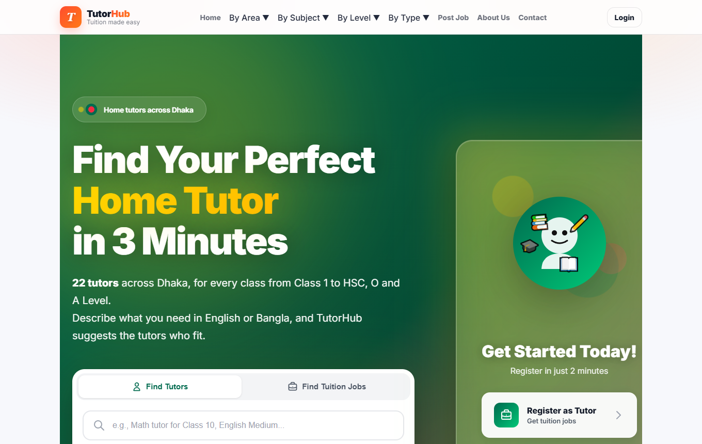

*The home page. Parents search for a tutor or describe what they need; tutors register to find tuition jobs.*

## What it does

TutorHub is a website where parents in Dhaka find a home tutor for their child, and tutors find students. A parent writes what they need in their own words, and the site fills in the job form, suggests the tutors who fit best and says why. A TutorHub team member checks every match before anyone's phone number or address is shared.

## A real-life example

**Nadia** lives in Uttara and needs a female tutor for her daughter in Class 9, for physics and higher maths.

- **Before:** she spent her evenings asking neighbours, scrolling tutor groups and phoning numbers from posters. Most tutor sites wanted a long form filled in, and posting her request in public groups meant handing her phone number to strangers.
- **With TutorHub:** she types one sentence the way she would say it to a friend, in Banglish (Bangla written in English letters): *"Amar meye class 9 e pore, physics ar higher math er jonno female tutor lagbe. Uttara sector 7, saptahe 3 din, 12k dite parbo."* ("My daughter is in Class 9 and needs a female tutor for physics and higher maths. Uttara sector 7, 3 days a week, I can pay 12k.") The form fills itself: Class 9, physics and higher maths, Uttara, a female tutor, three days a week, 12,000 taka a month. She checks it and posts the job. The page then shows the five tutors who fit best, each with a score out of 100 and the reasons behind it, and she invites the one she likes with one click.
- **After:** with the AI switched on, the form-filling step got every detail right on all 30 test requests in the project's own check (written in English, Bangla and Banglish), so Nadia only has to read and confirm. Her address and phone number stay hidden until the TutorHub team confirms the match and shares them.

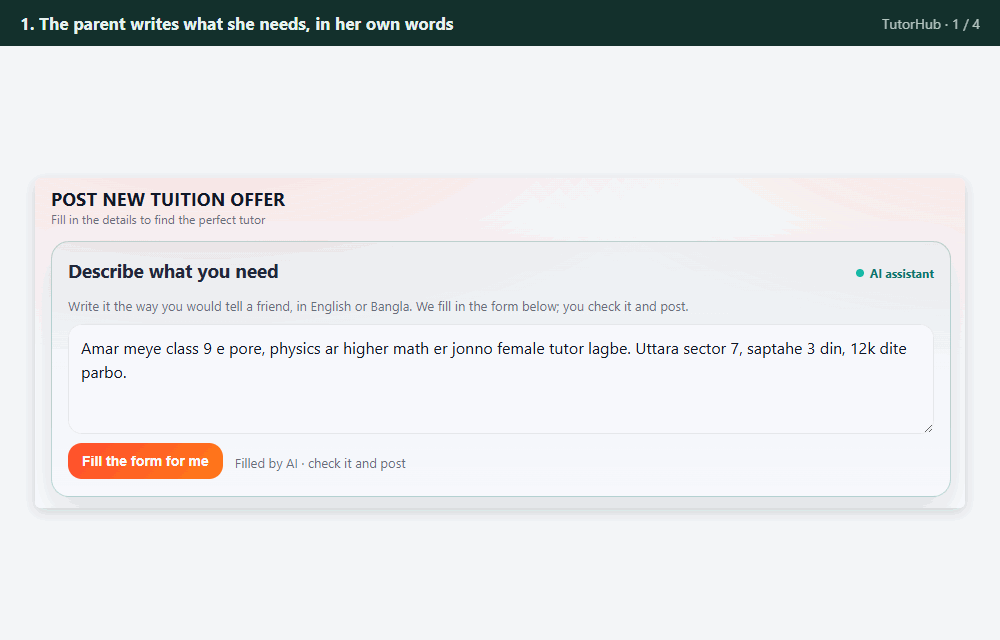

*The same journey in four real screens from the app: the parent writes the request, checks the filled form, picks from the tutors who fit, and the TutorHub team confirms the match before sharing contact details.*

## How you would use it

**As a parent**

1. Open the site, sign up as a parent and click **Post Job**.
2. In the **Describe what you need** box, write your request in English, Bangla or Banglish, and press **Fill the form for me**.
3. Check the filled form. Anything still missing is highlighted. Press **Post Offer**.
4. Read the list of **Tutors who fit this offer**, with a score and reasons for each, and click **Invite** on the ones you like.
5. When a tutor accepts, the TutorHub team confirms the match and shares the contact details with both of you.

**As a tutor**

1. Sign up as a tutor and fill in your subjects, classes, areas and fee.
2. Your dashboard lists the **Jobs that fit you**, best first.
3. Open a job to see **How you fit**, press **Draft my message** for a ready-made application, edit it and press **Send application**.

The technical setup is in [Getting started](#getting-started) further down.

## Key features

TutorHub is built with Laravel (a PHP framework for websites). Parents post a tuition job, tutors apply or get invited, and the TutorHub admin confirms each match before any contact details are shared. AI fills in the job form, explains why each suggested tutor fits, and drafts tutors' bios and applications. Every AI feature also has a rule-based path (fixed keyword rules written in code), so the whole site runs without an API key (the password for a paid AI service).

**Marketplace**

- **Parents** post, edit and close tuition jobs, browse tutors by subject, class, area and gender, invite the tutors they like, and accept or reject applications.
- **Tutors** build a profile (subjects, classes, areas, fee, education), see open jobs ranked for them, apply with a short message, and accept or decline invitations.
- **The admin** takes every accepted match from "with admin" to "contact shared": tutor contacted, commission recorded (cash, bKash, Nagad, bank transfer or other, one per match), then contact details shared.
- **Contact details stay private until a match is confirmed.** A parent's address and email reach the tutor only after the admin shares them. Parents see a tutor's public code (such as `T-1002`) rather than an email address. Public job pages show neither the parent's name nor the street address.
- **Browse pages** by area, subject, class level and tuition type.

**AI**

- **Offer intake.** A parent writes the request the way they would tell a friend, for example *"Class 8 er meyer jonno female math tutor lagbe, Mirpur, 3 din, 8000 taka"*, and the job form fills itself. Missing fields are highlighted for the parent to complete.
- **Tutor matching with explanations.** Each tutor gets a 0 to 100 score from seven weighted parts (subjects, class, area, budget, profile fit, experience, verification), with the reasons and concerns behind it and one plain sentence that sums it up.
- **Writing help.** Bio and cover-letter drafts written only from the tutor's own profile. A grounding guard (a check that the draft only states facts from the profile) replaces any draft that contains a number the profile does not have.
- **Trust review.** The admin sees profiles worth checking before verification: shared phone numbers, copied bios, the same cover letter from different tutors, and experience the tutor's age does not allow.
- **AI usage page.** Calls, cache hits (answers reused instead of asking the AI again), failures, median and p95 latency (the typical wait and the slowest one in twenty) and tokens (the units AI services charge by) per feature for the last seven days.
- **Optional and provider-agnostic.** One client for any OpenAI-compatible API (any AI service that accepts the same request format as OpenAI's), with Google's Gemini by default. Model answers pass the same allowlists as the forms, and nothing is posted until a person submits it.

## Architecture

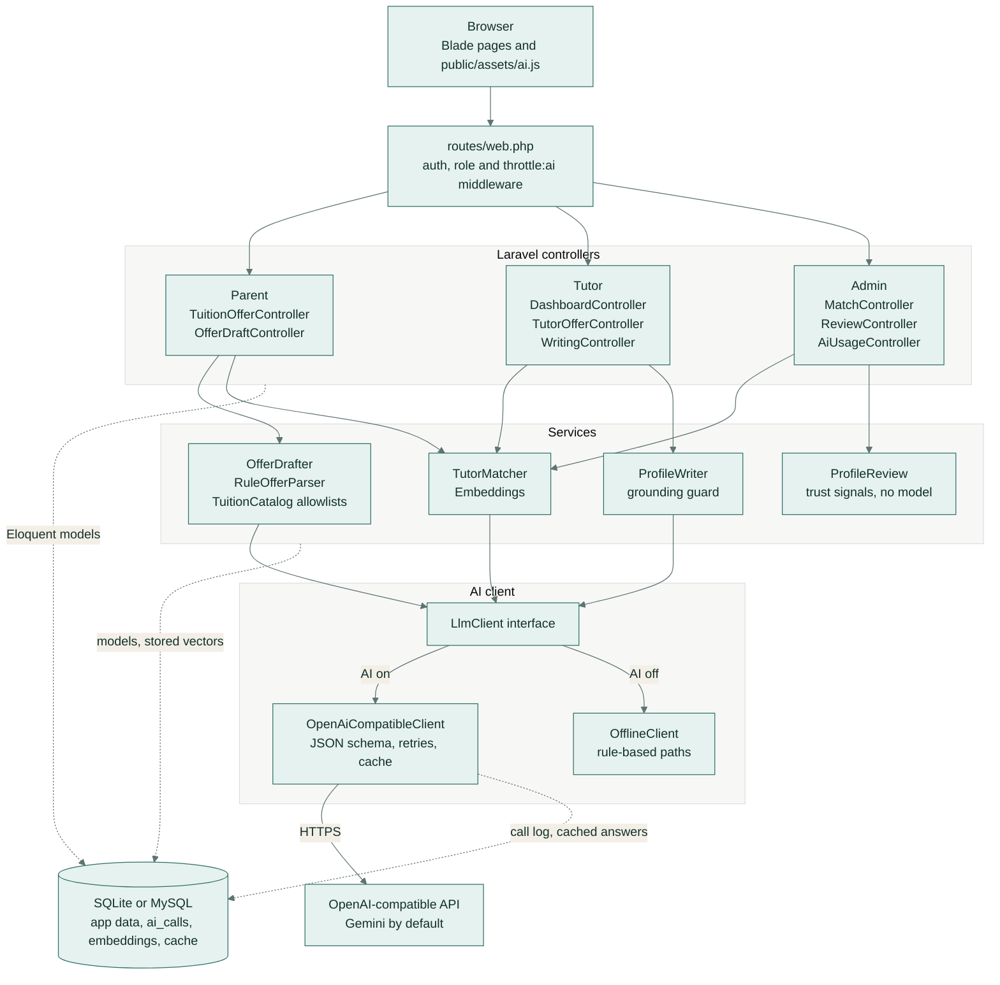

Solid arrows are requests; dotted arrows are database access.

- **Controllers** (the code that handles each page request) check access and validate input. Role middleware (checks that run before a page loads) guards the parent, tutor and admin areas, and `throttle:ai` limits the AI endpoints.
- **Services** hold the AI logic. `TuitionCatalog` is the single list of allowed classes, subjects and areas, used by the forms, the offer intake and the matcher.
- **`LlmClient`** is the only way the app talks to a model (LLM, a large language model: the AI that reads and writes text). `AppServiceProvider` binds `OpenAiCompatibleClient` when AI is on and `OfflineClient` when it is off. Every service that calls a model catches `AiException` and falls back to its rules.
- **The database** holds the marketplace data plus two AI tables: `ai_calls` (one row per model call) and `embeddings` (lists of numbers that capture what a text means, used to compare profiles; stored with a hash of their text, so an unchanged profile is not embedded again).

The design of each AI feature is described in detail in the [AI design reference](docs/engineering.md).

## How it works

The main flow, from a parent's request to a confirmed match:

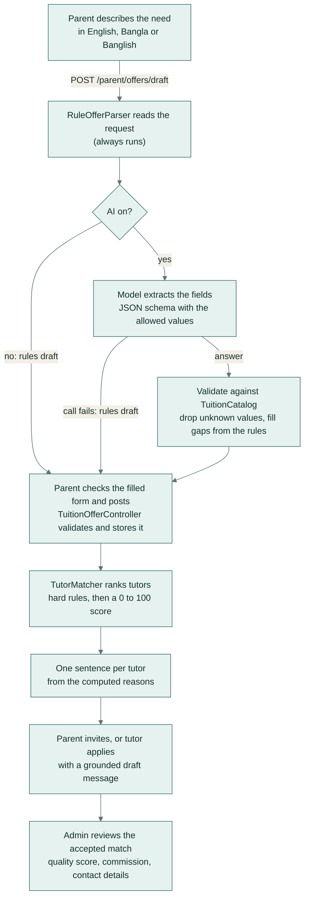

1. **The parent describes the need.** On **Post Job**, the parent writes the request in the "Describe what you need" box and presses **Fill the form for me**.
2. **Extraction.** `RuleOfferParser` always reads the text first: keywords and patterns for class, subjects, area, salary, days, tutor gender and tuition type in all three languages, including Bangla digits and amounts like "8k" or "৮ হাজার". With AI on, the model also gets the request, together with the allowed subjects, classes and areas, and answers in a fixed JSON schema (a strict, machine-readable answer format).
3. **Validation.** Every field of the model's answer is checked against `TuitionCatalog`; unknown values are dropped, days must be 1 to 7 and the salary 1,000 to 200,000 taka. Fields the model left empty are filled from the rules, and so is a tutor gender the rules found stated explicitly when the model answered "any". The form shows which source filled it and which required fields are still missing. When the parent posts, the form is validated against the same lists.
4. **Matching.** The offer page ranks tutors who pass the hard rules (an active profile, at least one subject in common, the requested gender). Each gets a score out of 100 with reasons and concerns. The top five are shown, and one model call writes a sentence for each from those facts. Without AI, the sentence is built from the top reasons.
5. **Invite or apply.** The parent invites a suggested tutor with one click. Tutors see open jobs ranked for them, a "How you fit" panel on each job, and a **Draft my message** button whose output passes the grounding guard.
6. **Admin confirmation.** An accepted application or invitation goes to **Manage Matches**. The admin sees the match quality score, marks the tutor as contacted, records the commission and shares the contact details. Separately, **Profiles to Review** lists tutors with trust signals before they are verified.

## Screenshots

**A parent writes the request in Banglish, and the form fills itself**
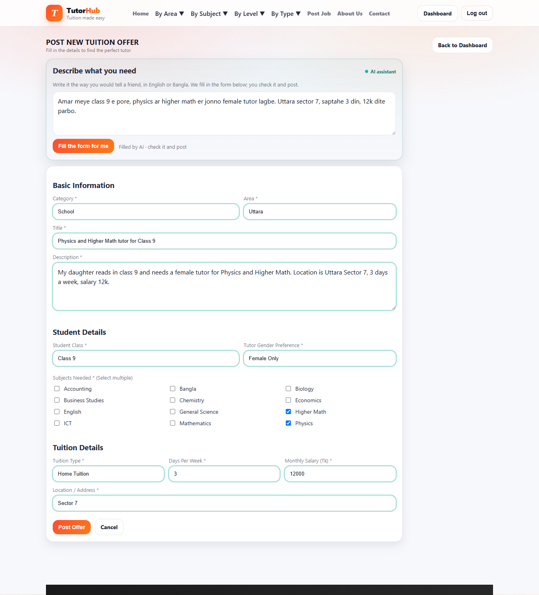

**Tutors who fit the job, each with a score, reasons and a one-click invite**
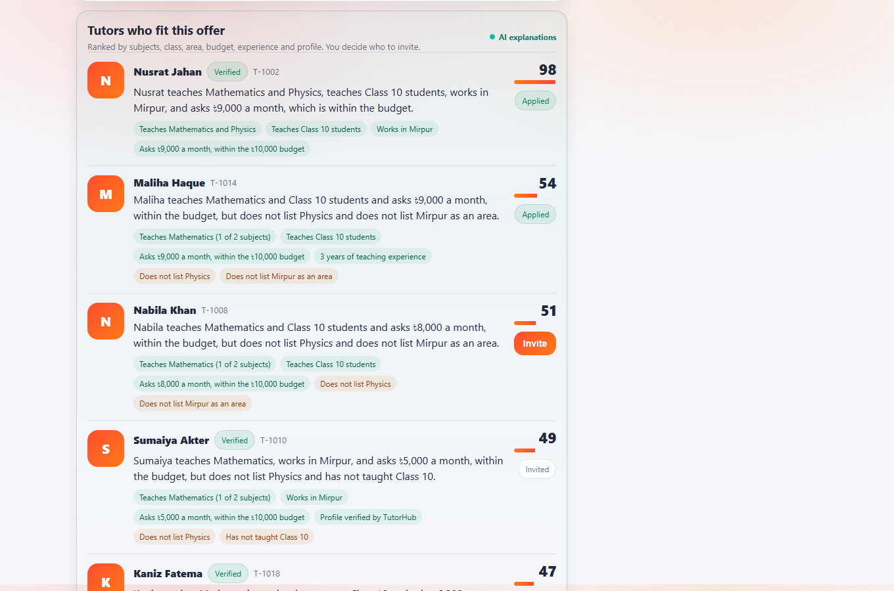

**A tutor applies: how they fit the job, plus a drafted message to edit**
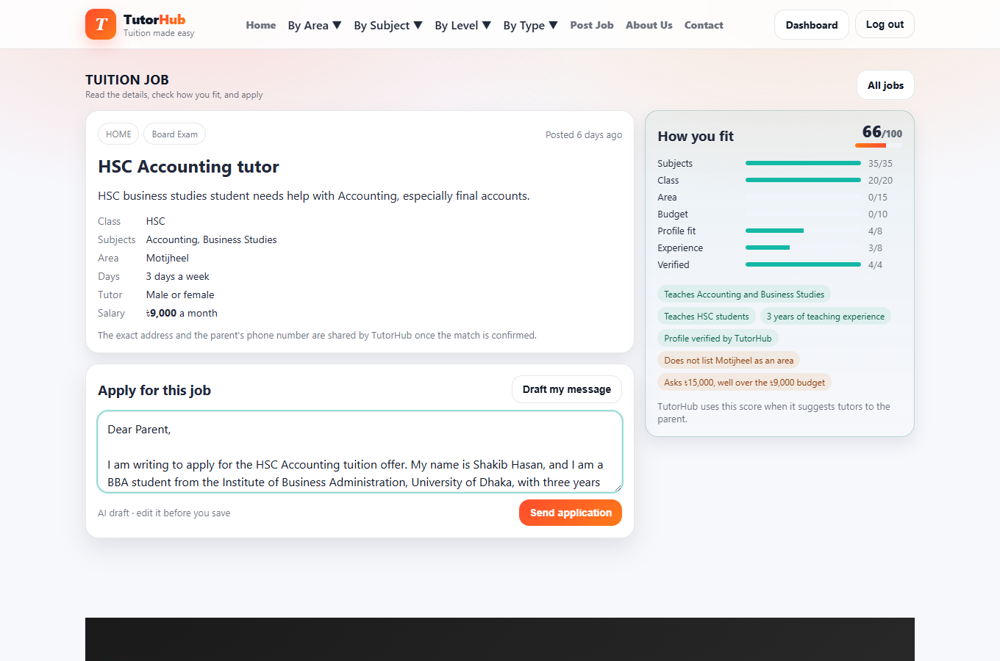

| | |
|---|---|
| 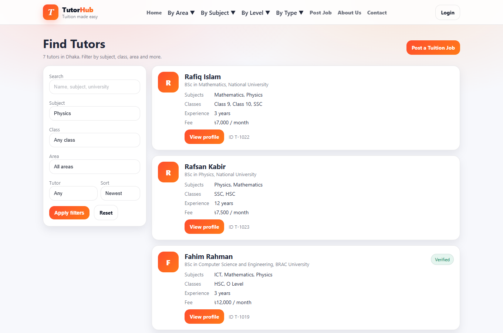 | 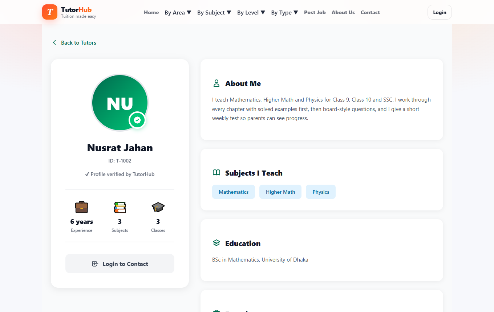 |
| **Find tutors** by subject, class, area and gender | **A tutor's profile**: subjects, education, experience and public code |
| 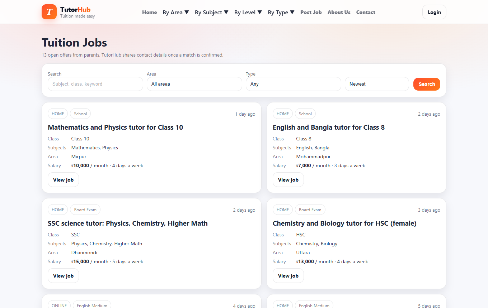 | 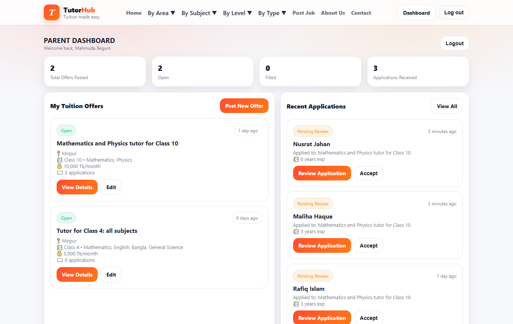 |
| **Tuition jobs** open to tutors (the address stays private) | **The parent's dashboard**: their jobs and the applications |
| 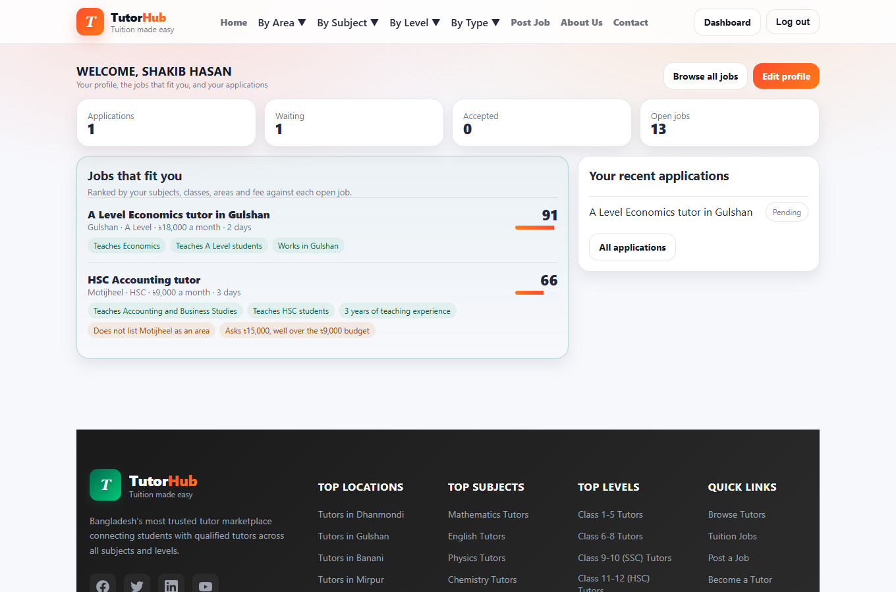 | 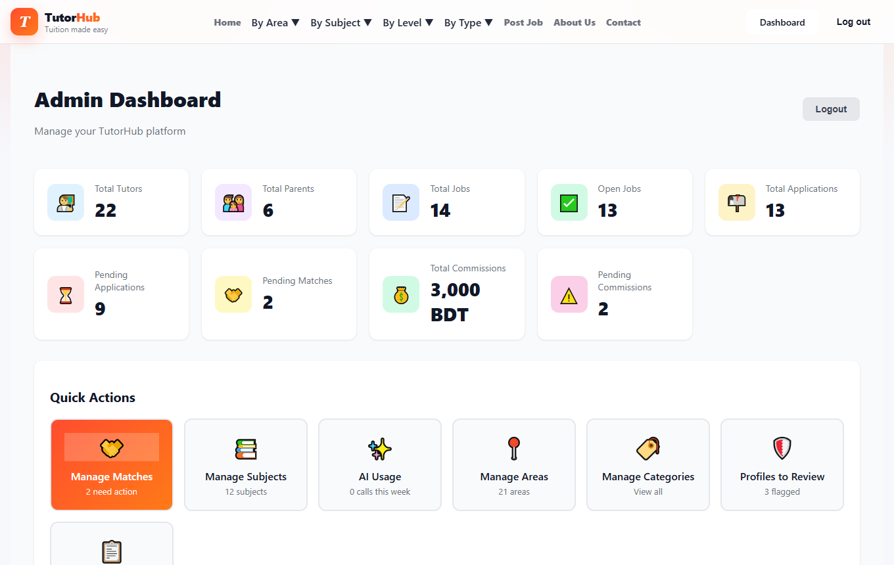 |
| **The tutor's dashboard**: jobs ranked for them | **Admin dashboard**: totals and quick actions |
| 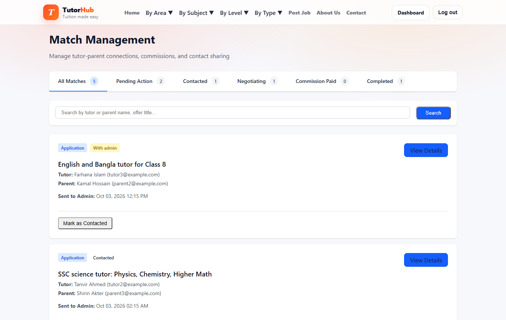 | 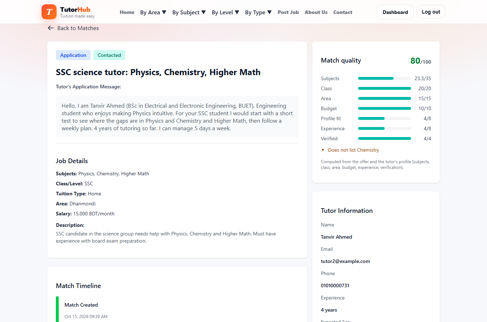 |
| **Match management**: from "with admin" to contact shared | **One match** with its quality score, part by part |
| 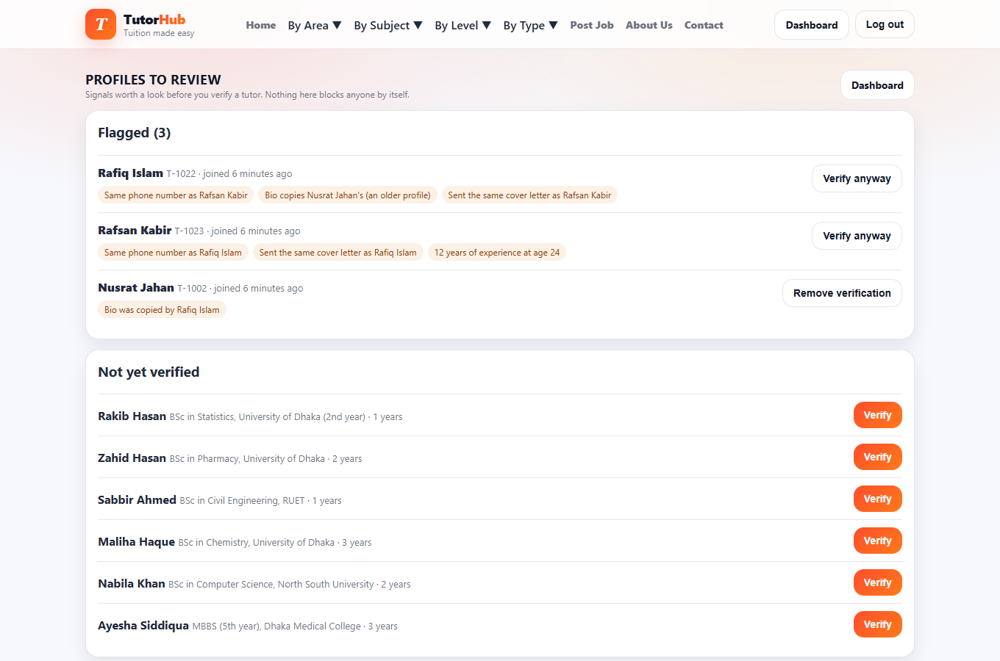 | 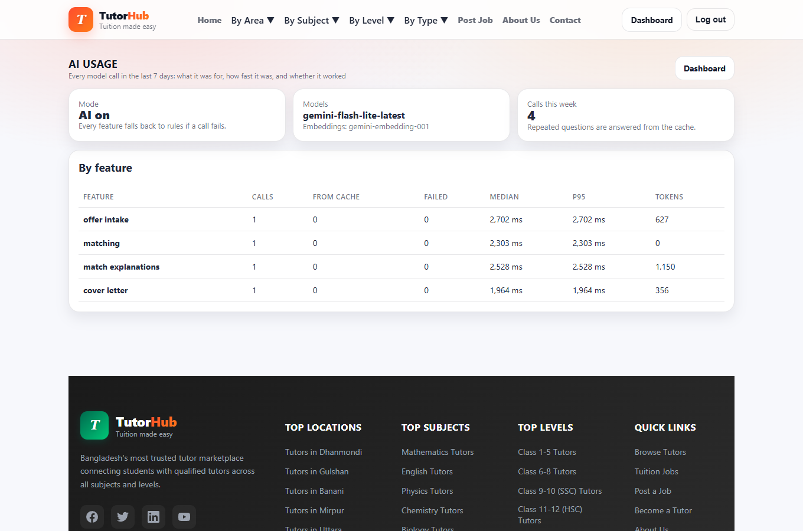 |
| **Profiles to review**, with the reason for each flag | **AI usage**: calls, failures, latency and tokens per feature |

## Tech stack

- **Backend:** Laravel 12 on PHP 8.2+, Eloquent, Blade templates.
- **Front end:** server-rendered Blade with plain CSS and JavaScript in `public/assets` (`ai.js` drives the AI buttons); Tailwind CSS 4 built with Vite 7 for the admin match pages.
- **Database:** SQLite for local development (the `.env.example` default) or MySQL (set `DB_CONNECTION=mysql` and the `DB_*` variables).
- **AI:** any OpenAI-compatible chat and embeddings API through Laravel's HTTP client, with no SDK. Defaults: `gemini-flash-lite-latest` for chat and `gemini-embedding-001` for embeddings.
- **Tests and CI:** PHPUnit 11 and GitHub Actions.

## Getting started

### Prerequisites

- PHP 8.2 or newer, with `pdo_sqlite` (or `pdo_mysql` for MySQL) and `mbstring`
- Composer
- Node.js 20.19+ or 22.12+ (for the Vite build)

### Install and run

```bash
git clone https://github.com/samiulhuda360/tutorhub-marketplace.git
cd tutorhub-marketplace
composer install
npm install
npm run build                    # Tailwind for the admin match pages
cp .env.example .env
php artisan key:generate
touch database/database.sqlite   # SQLite is the default database
php artisan migrate --seed       # schema, lookup data and demo data
php artisan serve                # http://127.0.0.1:8000
```

The demo data has 22 tutors, 6 parents and 14 tuition jobs, with matches at every stage. All people and data are made up. To reset it, run `php artisan migrate:fresh --seed`.

### Configuration

Settings live in `.env` (copied from `.env.example`). The AI settings are read in `config/ai.php`.

| Variable | Purpose |
|---|---|
| `APP_KEY` | Encryption key, set by `php artisan key:generate` |
| `APP_URL` | Base URL of the site |
| `DB_CONNECTION` | `sqlite` (default) or `mysql` |
| `DB_HOST`, `DB_PORT`, `DB_DATABASE`, `DB_USERNAME`, `DB_PASSWORD` | MySQL connection settings |
| `CACHE_STORE` | Laravel cache store; it also holds cached model answers |
| `AI_DRIVER` | `auto` uses the provider when `AI_API_KEY` is set, `live` always uses it, `off` never calls a model |
| `AI_BASE_URL` | Base URL of an OpenAI-compatible API (Gemini's by default) |
| `AI_API_KEY` | Provider API key. Leave it empty to run every feature on its rule-based path |
| `AI_CHAT_MODEL` | Chat model for extraction, explanations and drafts |
| `AI_EMBEDDING_MODEL` | Embedding model for profile similarity |
| `AI_TIMEOUT` | Optional: seconds before a model request times out |
| `AI_CACHE_DAYS` | Optional: days to keep cached model answers |

To turn the AI features on, set `AI_API_KEY`. A Gemini API key from Google AI Studio works with the defaults. For OpenAI, OpenRouter, Groq or a local Ollama, change `AI_BASE_URL` and the two model names. If a provider has no embeddings endpoint, matching uses its built-in lexical vectors (word-overlap comparisons that need no AI service) instead.

### Demo logins

| Role | Email | Password |
|---|---|---|
| Parent | `parent1@example.com` (to `parent6`) | `password` |
| Tutor | `tutor1@example.com` (to `tutor22`) | `password` |
| Admin | `admin@tutorhub.test`, at `/admin/login` | `Admin@1234` |

## Usage

### A walkthrough

1. **As a parent** (`parent1@example.com`), open **Post Job**, describe the need in the "Describe what you need" box and press **Fill the form for me**. Check the highlighted fields and press **Post Offer**.
2. The offer page lists **Tutors who fit this offer**, each with a score, reasons, concerns and an **Invite** button.
3. **As a tutor** (`tutor1@example.com`), the dashboard ranks **Jobs that fit you**. A job page shows **How you fit**, and **Draft my message** writes an application to edit before **Send application**.
4. **As the admin** (`/admin/login`), open **Manage Matches** and **View Details** on a match: the page shows the match quality, then **Mark as Contacted**, **Record Commission** and **Share Contact Details**. **Profiles to Review** and **AI Usage** are on the dashboard.

### Main routes

| Route | Who | What |
|---|---|---|
| `/`, `/tutors`, `/tutors/{code}`, `/tuition-offers` | Everyone | Home, tutor directory and profiles, open jobs |
| `/subject/{slug}`, `/level/{slug}`, `/type/{type}`, `/location/{mainArea}/{subArea}` | Everyone | Browse pages |
| `/parent/dashboard`, `/parent/offers/create`, `/parent/offers/{offer}` | Parent | Jobs, posting, suggested tutors |
| `POST /parent/offers/draft` | Parent | AI: request text in, draft offer out (JSON) |
| `/tutor/dashboard`, `/tutor/offers/{offer}` | Tutor | Jobs that fit, a job with "How you fit" |
| `POST /tutor/profile/bio-draft`, `POST /tutor/offers/{offer}/cover-letter` | Tutor | AI: bio and cover-letter drafts (JSON) |
| `/admin`, `/admin/matches`, `/admin/review`, `/admin/ai` | Admin | Dashboard, match management, profiles to review, AI usage |

The three AI endpoints allow 15 requests a minute per user.

### Artisan commands

| Command | What it does |
|---|---|
| `php artisan ai:eval-intake` | Measures the offer intake on 30 labelled requests: rules, AI, and AI + rules. Without a key, only the rules are measured |
| `php artisan ai:eval-intake --out=docs/eval-offer-intake.md` | The same, and writes the Markdown report |
| `php artisan migrate:fresh --seed` | Rebuilds the database with the demo data |
| `php artisan test` | Runs the test suite |

## Project structure

```text
app/
  Ai/                  LlmClient, OpenAI-compatible and offline clients, call log, embeddings, ProfileWriter
  Console/Commands/    EvalOfferIntake (php artisan ai:eval-intake)
  Http/Controllers/    public, Parent, Tutor and Admin controllers
  Http/Middleware/     role and admin checks
  Matching/            TutorMatcher and MatchResult
  Models/              Eloquent models
  Offers/              OfferDrafter, RuleOfferParser and OfferDraft
  Support/             TuitionCatalog: allowed values and the words people use for them
  Trust/               ProfileReview
config/ai.php          AI provider settings
database/
  eval/                labelled requests for the offer intake eval
  migrations/          schema, including ai_calls and embeddings
  seeders/             lookup data and demo data
docs/                  AI design reference, eval report, screenshots
public/assets/         CSS and JavaScript for the site, ai.js for the AI buttons
resources/views/       Blade templates
routes/web.php         all web routes
tests/                 Unit and Feature tests
.github/workflows/     CI
LICENSE                MIT licence
```

## Testing

```bash
php artisan test
```

The suite has 66 PHPUnit tests. They run on an in-memory SQLite database with AI turned off in `phpunit.xml`. Tests for the AI paths use the real `OpenAiCompatibleClient` against a faked provider (`Http::fake`), so they need no key and no network.

- **Unit tests** cover the rule parser in all three languages, the drafter's sanitising and fallbacks, the HTTP client (schema, repair turn, cache, retries, embedding order), the matcher, the grounding guard and the trust review.
- **Feature tests** cover the main public, parent, tutor and admin pages, the full match flow from acceptance to commission to shared contact, role checks, the AI endpoints and their rate limit, contact details staying hidden until the admin shares them, and escaping of names in the invitation buttons.

**CI:** `.github/workflows/ci.yml` runs on every push and pull request. It runs the tests on PHP 8.2 and 8.3 and builds the front-end assets on Node 22.

## Evaluation

The offer intake is measured on 30 hand-labelled parent requests in English, Bangla and Banglish, one of which contains a prompt-injection attempt (text that tries to trick the AI into ignoring its instructions). Each request is scored on seven fields: class, subjects, area, tuition type, tutor gender, days a week and salary. Run on 2026-10-04 with `gemini-flash-lite-latest`:

| Approach | All 7 fields right | Median time |
|---|---|---|
| Rules only (`RuleOfferParser`) | 70% | 1 ms |
| AI only (model answer, sanitised) | 97% | 298 ms |
| AI + rules (what the app uses) | 100% | 230 ms |

The rules miss bare amounts with no currency or salary word, days written as "two days" or "3 evenings", "male" when it is not followed by "tutor" or "teacher", and two subject wordings. The model's one miss is "sir lagbe" (a male tutor) read as no preference; the rules catch it, so AI + rules gets all 30. The full report, with per-field scores and every miss, is in [docs/eval-offer-intake.md](docs/eval-offer-intake.md). How the three approaches work is in the [AI design reference](docs/engineering.md#evaluation).

## Licence

MIT. See [LICENSE](LICENSE). Copyright (c) 2026 Samiul Huda.
